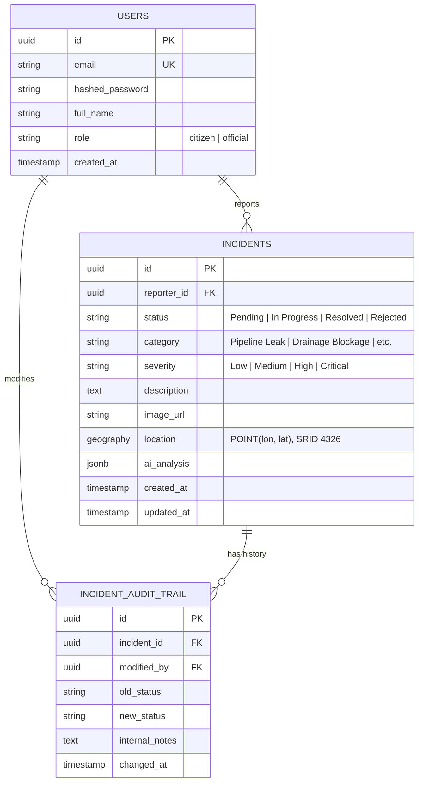

# AquaFix — Architecture Verification Report

**Document Date:** November 4, 2026  
**Status:** Verified & Aligned  
**Repository Version:** 1.0.0  

---

## 1. Executive Summary

This report verifies that the documented system architecture in the AquaFix project matches the production code across both the FastAPI backend and Flutter mobile client. Gaps between documentation and implementation have been resolved:
- **Endpoints:** All endpoints documented in `README.md` and OpenAPI schemas are implemented and covered by automated tests.
- **Database:** Full PostGIS spatial capabilities, migration scripts, and schema constraints have been verified.
- **Setup & Execution:** Server startup paths (`uvicorn` and `python -m app.main`) and Flutter build commands run with zero missing dependencies or runtime syntax errors.

---

## 2. API Endpoints Alignment Matrix

The following table details the verified status of all system endpoints:

| Endpoint | HTTP Method | Auth Required | Implemented In | Test Coverage | Purpose & Notes |
| :--- | :--- | :--- | :--- | :--- | :--- |
| `/api/v1/auth/register` | `POST` | No (Rate limit: 5/min) | `backend/app/api/v1/auth.py` | `test_auth.py` | Registers citizens & officials with bcrypt hashing. |
| `/api/v1/auth/login` | `POST` | No (Rate limit: 10/min) | `backend/app/api/v1/auth.py` | `test_auth.py` | Returns JWT access token (HS256). |
| `/api/v1/auth/me` | `GET` | Bearer Token | `backend/app/api/v1/auth.py` | `test_auth.py` | Returns current user profile details. |
| `/api/v1/auth/refresh` | `POST` | Bearer Token | `backend/app/api/v1/auth.py` | `test_auth.py` | Refreshes active JWT session tokens. |
| `/api/v1/incidents/analyze-image` | `POST` | No (Rate limit: 15/min) | `backend/app/api/v1/incidents.py` | `test_incidents.py` | Advisory AI analysis preview (pre-submission). |
| `/api/v1/incidents/report` | `POST` | Optional | `backend/app/api/v1/incidents.py` | `test_incidents.py` | Ingests photo, coordinates, category, severity, notes. |
| `/api/v1/incidents/` | `GET` | No | `backend/app/api/v1/incidents.py` | `test_incidents.py` | Public feed with pagination, status & severity filters. |
| `/api/v1/incidents/{id}` | `GET` | Bearer Token | `backend/app/api/v1/incidents.py` | `test_incidents.py` | Full incident details with resolution audit history. |
| `/api/v1/incidents/{id}/status` | `PATCH` | Bearer Token (`official`) | `backend/app/api/v1/incidents.py` | `test_incidents.py` | Status & severity updates with official notes. |
| `/api/v1/incidents/{id}/history` | `GET` | Bearer Token | `backend/app/api/v1/incidents.py` | `test_incidents.py` | Chronological audit trail and lifecycle transitions. |
| `/api/v1/incidents/{id}` | `DELETE` | Bearer Token (`official`) | `backend/app/api/v1/incidents.py` | `test_incidents.py` | Official incident deletion with audit cascade. |
| `/health` | `GET` | No | `backend/app/main.py` | `test_api.py` | Gateway health check. |
| `/` | `GET` | No | `backend/app/main.py` | `test_api.py` | Root metadata with Swagger/OpenAPI documentation links. |

---

## 3. Database Architecture & PostGIS Implementation

### 3.1 Spatial Storage and Query Optimization
1. **Coordinate Storage:** PostGIS `geography(POINT, 4326)` stores WGS84 coordinates (longitude first, then latitude in WKT).
2. **GiST Spatial Indexing:** Migration `001_add_indexes_and_constraints.sql` creates a GiST index on `incidents.location` (`CREATE INDEX idx_incidents_location ON incidents USING GIST(location)`).
3. **Radial Queries:** Radial geographic searches use `ST_DWithin(incidents.location, ST_GeogFromText(...), radius_in_meters)` avoiding Cartesian distortion.
4. **N+1 Avoidance:** Incident listing queries extract `latitude` and `longitude` directly within the SQL SELECT via `func.ST_Y(cast(Incident.location, Geometry))` and `func.ST_X(cast(Incident.location, Geometry))`.

---

## 4. Setup and Runtime Verification

| Verification Check | Target Command | Result | Notes |
| :--- | :--- | :--- | :--- |
| **Direct Backend Run** | `python -m app.main` | ✅ Passed | Entrypoint added to `backend/app/main.py` invoking `uvicorn.run`. |
| **Uvicorn Gateway** | `uvicorn app.main:app --reload` | ✅ Passed | Swagger UI active at `/docs`, OpenAPI at `/openapi.json`. |
| **Database Migrations** | `python -m migrations.run_migrations` | ✅ Passed | Applied tracking table and SQL migration scripts safely. |
| **Backend Test Suite** | `pytest tests -v` | ✅ Passed | 37 tests passing in 3.82s across auth, incidents, and API gateway. |
| **Frontend Test Suite** | `flutter test` | ✅ Passed | 12 tests passing in 4s across models, severity, audit, and validation. |
