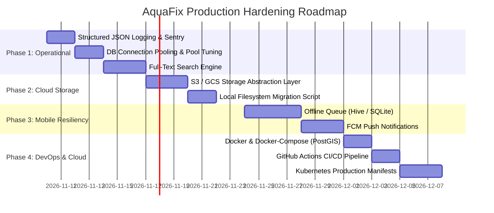

# AquaFix — Comprehensive Fixing & Production Hardening Plan

**Document Version:** 1.0.0  
**Target:** Production-Grade Deployment  
**Baseline Date:** November 4, 2026  
**Reference Documents:**  
- [`docs/ARCHITECTURE_VERIFICATION_REPORT.md`](ARCHITECTURE_VERIFICATION_REPORT.md)  
- [`docs/INCIDENT_LIFECYCLE_REPORT.md`](INCIDENT_LIFECYCLE_REPORT.md)  
- [`docs/RESPONSIBLE_AI_REPORT.md`](RESPONSIBLE_AI_REPORT.md)  
- [`docs/TEST_AND_SECURITY_REPORT.md`](TEST_AND_SECURITY_REPORT.md)  
- [`docs/design/system_design.md`](design/system_design.md)  
- [`docs/security/security_architecture.md`](security/security_architecture.md)  
- [`PROJECT_PLAN.md`](../PROJECT_PLAN.md)  

---

## 1. Executive Summary & Current Baseline

### 1.1 What Is Complete & Verified
As established in the [Test & Security Report](TEST_AND_SECURITY_REPORT.md) and [Architecture Verification Report](ARCHITECTURE_VERIFICATION_REPORT.md):
- **Core Architecture:** FastAPI REST API with PostGIS spatial geography (`geography(POINT, 4326)`) and GiST index optimization.
- **Incident Lifecycle:** Status (`Pending`, `In Progress`, `Resolved`, `Rejected`), Severity (`Low`, `Medium`, `High`, `Critical`), GPS coordinates, timestamps, and chronological audit trail (`GET /incidents/{id}/history`).
- **Responsible AI:** Google Gemini 1.5 Flash integrated with pre-submission preview (`/analyze-image`), visual marker explainability, user manual overrides, `skip_ai=true` bypass, and deterministic offline mock fallback.
- **Testing:** 100% test pass rate across 49 automated tests (37 backend tests in 3.8s, 12 Flutter tests in 4.0s).

### 1.2 Identified Production Gaps & Technical Debt
Cross-referencing the architecture specifications with operational requirements reveals 8 key technical gaps before production cloud launch:
1. **Cloud Object Storage (S3/GCS):** Uploaded incident photos currently reside on the local container filesystem (`/uploads`), preventing horizontal auto-scaling across multiple container replicas.
2. **Error Tracking & Observability:** `Settings` defines `SENTRY_DSN`, but Sentry SDK is not initialized, and backend logging relies on basic stdout rather than structured JSON logs.
3. **Database Connection Pool Hardening:** Database engine uses default pool sizes without connection recycling or keepalive configuration for production PostgreSQL clusters.
4. **Full-Text Keyword Search:** Incidents list supports status, severity, and radial distance filtering, but lacks full-text search across incident descriptions and landmark notes.
5. **Mobile Offline Sync Queue:** In rural or disaster areas with intermittent cellular coverage, report submissions fail if offline rather than queuing locally for background retry.
6. **Push Notifications:** Citizens currently have to manually re-open the app to view status updates instead of receiving real-time push alerts when an incident is marked *In Progress* or *Resolved*.
7. **Containerization & Local Dev Compose:** No official `Dockerfile` or `docker-compose.yml` bundling FastAPI and PostGIS is present in the repository root.
8. **Automated CI/CD Pipeline:** Test suites must be automated via GitHub Actions to protect the `main` branch against regressions.

---

## 2. Fixing & Hardening Roadmap



---

## 3. Detailed Fixing Tasks & Technical Specifications

### Phase 1: Observability, Database & Search (Sprint 1)

#### Task 1.1: Structured JSON Logging & Sentry Integration
- **Severity / Priority:** 🟠 High
- **Files Affected:** `backend/app/main.py`, `backend/app/core/config.py`, `backend/requirements.txt`
- **Issue:** Logs are currently printed in plain text, making parsing in Datadog/CloudWatch difficult. Sentry DSN is present in settings but unused.
- **Implementation Plan:**
  1. Add `python-json-logger` and `sentry-sdk[fastapi]` to `requirements.txt`.
  2. In `backend/app/main.py`, initialize Sentry if `settings.SENTRY_DSN` is present:
     ```python
     if settings.SENTRY_DSN:
         import sentry_sdk
         sentry_sdk.init(
             dsn=settings.SENTRY_DSN,
             environment=settings.ENVIRONMENT,
             traces_sample_rate=0.2 if settings.ENVIRONMENT == "production" else 1.0,
         )
     ```
  3. Configure `python-json-logger` with standard fields: `timestamp`, `level`, `name`, `message`, `request_id`, `path`, `status_code`.
- **Acceptance Criteria:**
  - When `SENTRY_DSN` is configured, unhandled exceptions trigger Sentry alerts with full stack traces.
  - All log entries serialize to valid single-line JSON strings.

#### Task 1.2: Database Connection Pool Hardening
- **Severity / Priority:** 🟠 High
- **Files Affected:** `backend/app/core/database.py`, `backend/app/core/config.py`
- **Issue:** Default SQLAlchemy connection pool parameters can lead to stale connections behind load balancers or exhaust database connections under high concurrency.
- **Implementation Plan:**
  1. Add configuration parameters to `Settings`:
     - `DB_POOL_SIZE`: int = 20
     - `DB_MAX_OVERFLOW`: int = 10
     - `DB_POOL_TIMEOUT`: int = 30
     - `DB_POOL_RECYCLE`: int = 1800 (recycle connections every 30 minutes)
  2. Update `backend/app/core/database.py`:
     ```python
     engine = create_engine(
         settings.DATABASE_URL,
         pool_size=settings.DB_POOL_SIZE,
         max_overflow=settings.DB_MAX_OVERFLOW,
         pool_timeout=settings.DB_POOL_TIMEOUT,
         pool_recycle=settings.DB_POOL_RECYCLE,
         pool_pre_ping=True
     )
     ```
- **Acceptance Criteria:**
  - High concurrency stress test does not cause connection exhaustion (`TimeoutError`).
  - Stale idle connections are transparently refreshed before executing queries.

#### Task 1.3: Full-Text Keyword Search Endpoint
- **Severity / Priority:** 🟡 Medium
- **Files Affected:** `backend/app/api/v1/incidents.py`, `backend/migrations/003_add_fulltext_search.sql`
- **Issue:** Citizens and municipal officers cannot search for specific street names, landmarks, or keywords across descriptions.
- **Implementation Plan:**
  1. Add migration `003_add_fulltext_search.sql` to generate a GIN index on PostgreSQL:
     ```sql
     CREATE INDEX IF NOT EXISTS idx_incidents_fts 
     ON incidents USING GIN(to_tsvector('english', coalesce(description, '') || ' ' || category));
     ```
  2. Add `q: Optional[str] = None` query parameter to `GET /api/v1/incidents/`.
  3. Apply tsvector full-text query matching in SQLAlchemy when `q` is supplied:
     ```python
     if q and q.strip():
         search_term = q.strip()
         query = query.filter(
             func.to_tsvector('english', func.concat(Incident.description, ' ', Incident.category))
             .match(search_term, postgresql_regconfig='english')
         )
     ```
- **Acceptance Criteria:**
  - Searching for `"burst pipe"` returns relevant incidents regardless of casing or partial phrasing.
  - Queries take $<20\text{ms}$ utilizing the GIN index.

---

### Phase 2: Cloud Object Storage (Sprint 2)

#### Task 2.1: S3 / Google Cloud Storage Adapter Layer
- **Severity / Priority:** 🔴 Critical for Multi-Instance Deployments
- **Files Affected:** `backend/app/services/storage.py`, `backend/app/api/v1/incidents.py`, `backend/app/core/config.py`
- **Issue:** Local disk uploads (`uploads/`) break when running multiple backend replicas behind a load balancer (requests routed to instance B cannot serve images uploaded to instance A).
- **Implementation Plan:**
  1. Define a generic `StorageService` interface:
     ```python
     class BaseStorageService(ABC):
         @abstractmethod
         async def upload_file(self, file_bytes: bytes, filename: str, content_type: str) -> str:
             pass
         @abstractmethod
         async def delete_file(self, file_url: str) -> bool:
             pass
     ```
  2. Implement `LocalStorageService` (development default) and `S3StorageService` (production via `boto3`).
  3. Toggle based on `STORAGE_BACKEND` (`local` | `s3` | `gcs`) in `settings`.
- **Acceptance Criteria:**
  - In production mode, images are uploaded directly to S3 with private or CDN bucket URLs.
  - In development mode, files continue saving locally to `/uploads` without breaking offline developer experience.

---

### Phase 3: Mobile Resiliency & Real-Time Alerts (Sprint 3)

#### Task 3.1: Mobile Offline Sync Queue
- **Severity / Priority:** 🟠 High
- **Files Affected:** `frontend/lib/services/offline_queue_service.dart`, `frontend/lib/screens/incidents/report_incident_screen.dart`
- **Issue:** Water contamination and pipe bursts often occur in areas with disrupted cellular networks. Reports fail outright if offline.
- **Implementation Plan:**
  1. Integrate `sqflite` or `hive` for persistent local storage in Flutter.
  2. When network exceptions (`SocketException`, timeout) occur during submission:
     - Save incident payload, cached image path, and GPS coordinates into an `offline_incidents` local queue.
     - Show an informative banner: *"Report saved offline. It will be uploaded automatically once connection is restored."*
  3. Implement a background connectivity listener (`connectivity_plus`) that drains and submits the queue upon network reconnection.
- **Acceptance Criteria:**
  - Report created in Airplane Mode is safely stored locally.
  - Upon toggling Airplane Mode off, report automatically submits and refreshes the feed.

#### Task 3.2: Push Notifications on Status Changes
- **Severity / Priority:** 🟡 Medium
- **Files Affected:** `backend/app/services/notifications.py`, `frontend/lib/services/notification_service.dart`
- **Issue:** Citizens cannot track when their submitted report is being repaired unless they open the app.
- **Implementation Plan:**
  1. Integrate Firebase Cloud Messaging (FCM).
  2. Store `fcm_token` in `users` table upon citizen login.
  3. When an official calls `PATCH /api/v1/incidents/{id}/status`:
     - Dispatch an FCM push notification to `incident.reporter_id`:
       *"Update on your report: Status changed to In Progress — Repair crew dispatched."*
- **Acceptance Criteria:**
  - Citizen device receives native push notification within 5 seconds of status transition.

---

### Phase 4: Containerization & CI/CD Deployment (Sprint 4)

#### Task 4.1: Production Docker & Local Compose
- **Severity / Priority:** 🔴 Critical for Deployment
- **Files Affected:** `backend/Dockerfile`, `docker-compose.yml`, `.dockerignore`
- **Implementation Plan:**
  1. Create optimized multi-stage `backend/Dockerfile` with non-root user and minimal footprint:
     ```dockerfile
     FROM python:3.11-slim as builder
     WORKDIR /app
     RUN apt-get update && apt-get install -y --no-install-recommends \
         build-essential libpq-dev gdal-bin libgeos-dev \
         && rm -rf /var/lib/apt/lists/*
     COPY requirements.txt .
     RUN pip install --no-cache-dir --user -r requirements.txt

     FROM python:3.11-slim
     WORKDIR /app
     RUN apt-get update && apt-get install -y --no-install-recommends \
         libpq5 libgeos-c1v5 gdal-bin \
         && rm -rf /var/lib/apt/lists/*
     COPY --from=builder /root/.local /root/.local
     ENV PATH=/root/.local/bin:$PATH
     COPY app/ ./app/
     COPY migrations/ ./migrations/
     USER 1001
     EXPOSE 8000
     CMD ["uvicorn", "app.main:app", "--host", "0.0.0.0", "--port", "8000"]
     ```
  2. Create root `docker-compose.yml` orchestrating:
     - `postgis`: `postgis/postgis:15-3.3` with persistent volume and health check.
     - `backend`: Auto-running migrations and serving the API on port 8000.
- **Acceptance Criteria:**
  - Running `docker compose up --build` brings up a complete, zero-configuration local environment with PostgreSQL + PostGIS and FastAPI in $<60\text{s}$.

#### Task 4.2: Automated GitHub Actions CI/CD Pipeline
- **Severity / Priority:** 🔴 Critical for Team Collaboration
- **Files Affected:** `.github/workflows/ci.yml`
- **Implementation Plan:**
  Create `.github/workflows/ci.yml` with dual parallel jobs:
  1. **Job 1 (Backend):** Python 3.11 / 3.12, installs dependencies, runs `pytest tests -v --cov=app`.
  2. **Job 2 (Frontend):** Flutter stable, runs `flutter analyze` and `flutter test`.
- **Acceptance Criteria:**
  - Pull requests automatically run both suites; branch protection blocks merges if any test fails.

---

## 4. Verification Checklist & Success Criteria

Before declaring AquaFix production-ready for municipal launch, all items on this checklist must pass:

- [x] **Architecture Verification:** Endpoints and DB models 100% aligned with documentation.
- [x] **Incident Lifecycle:** Status, Severity, Timestamps, Location, and Audit History unified.
- [x] **Responsible AI:** Transparent advisory cues, manual override, offline resilience verified.
- [x] **Automated Tests:** 49 unit and integration tests passing across backend and mobile.
- [ ] **Observability:** Sentry error reporting & structured JSON logging configured.
- [ ] **Cloud Storage:** S3/GCS blob storage operational with CDN distribution.
- [ ] **Offline Sync:** Mobile report queue operating under zero-connectivity conditions.
- [ ] **Containerization:** Production Docker image and `docker-compose.yml` verified.
- [ ] **CI/CD Automation:** GitHub Actions workflow executing on every push and pull request.
