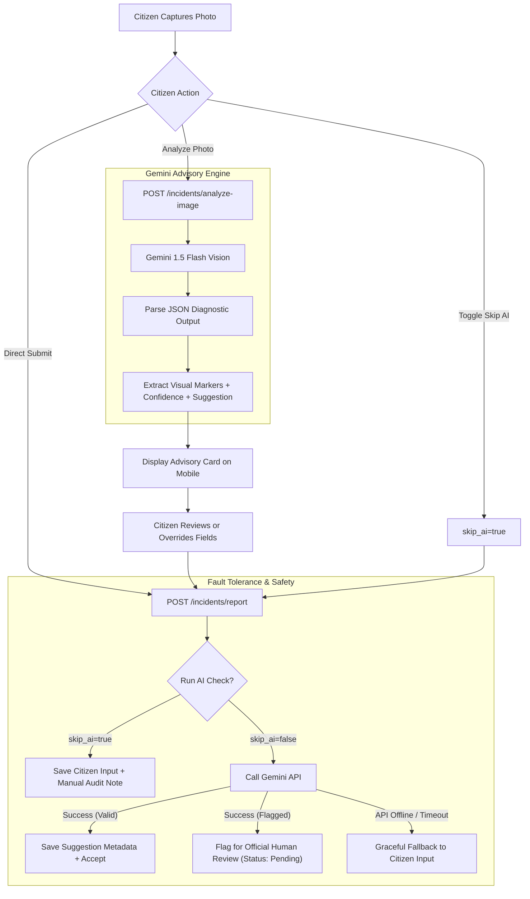

# AquaFix — Responsible AI & Vision Assistance Report

**Document Date:** November 4, 2026  
**Status:** Implemented & Verified  
**AI Model:** Google Gemini 1.5 Flash (with Local Deterministic Mock Fallback)  

---

## 1. Responsible AI Architecture

The AquaFix AI integration adheres strictly to human-centered and safe AI design principles. Rather than using AI as an autonomous decision-maker that can reject citizen reports or dictate municipal policy, Google Gemini 1.5 Flash is positioned as an **advisory diagnostic assistant**.



---

## 2. Four Core Safety & Utility Guarantees

### 2.1 Advisory Suggestions (Not Administrative Mandates)
- The AI output is presented to users and officials as an **advisory recommendation**, never as an infallible decision.
- The AI suggests:
  - **Category:** e.g. *Pipeline Leak*, *Drainage Blockage*, *Overflowing Sewage*, *Road Sinkhole*, *Public Sanitation Issue*.
  - **Severity:** e.g. *Critical*, *High*, *Medium*, *Low*.
  - **Confidence:** Percentage rating (0% to 100%).
  - **Reasoning:** Transparent explanation in plain language.
  - **Visual Markers:** Key cues identified in the image (e.g. `["water eruption", "fractured road pavement", "puddle accumulation"]`).

### 2.2 Explainability & User Transparency
- On the mobile client, the **AI Assistance Card** clearly shows what visual cues were detected.
- Every analysis includes a user disclaimer:
  > *"AI suggestions are advisory. You have full control to edit or override any fields before submitting."*
- When viewed by municipal officials in the incident detail view, the AI analysis breakdown is retained in the `ai_analysis` JSONB column, providing officials with instant triage context.

### 2.3 Citizen Autonomy & Manual Bypass
- **Pre-Submission Preview:** Citizens can tap **"Analyze Photo"** to inspect what Gemini sees before submitting.
- **Full Field Overrides:** Users can change the category dropdown or severity chips at any time.
- **Manual Mode Toggle:** Citizens can toggle **"Submit without AI analysis"** (`skip_ai=true`) to submit purely manual reports.

### 2.4 Fail-Safe Offline Resilience
- **No Lost Reports:** If the external Gemini API is unreachable, quota-throttled, or times out, the backend **does not throw a 503 error or reject the submission**. It safely ingests the report with citizen-provided values and attaches an audit record:
  > *"AI analysis service was unavailable. Ingested with user manual input; queued for human review."*
- **No False Rejections:** If Gemini returns `is_infrastructure_issue=false` (e.g. flagging a borderline case as spam), but the citizen has typed an explanation or chosen a category, the report is accepted under `status="Pending"` and flagged for human official review rather than abruptly rejected.
- **Mock Mode for Offline & Test Environments:** If `GEMINI_API_KEY` is empty, the system automatically uses a deterministic mock vision service to ensure testing, local development, and CI/CD pipelines run without external network dependencies.

---

## 3. Gemini Vision Advisory Prompt Specification

The backend prompt is engineered to enforce structured, deterministic JSON output without extraneous commentary:

```text
You are an expert municipal infrastructure auditor and public safety inspector.
Analyze the uploaded image and perform four advisory tasks:
1. SPAM FILTERING: Verify if the image depicts a public utility, municipal infrastructure,
   or public sanitation/water issue.
2. AUTO-CATEGORIZATION: Categorize into one of these strict categories:
   'Pipeline Leak', 'Drainage Blockage', 'Overflowing Sewage', 'Road Sinkhole', 'Public Sanitation Issue'.
3. SEVERITY ESTIMATION: Suggest severity level from:
   'Critical', 'High', 'Medium', 'Low'.
4. VISUAL MARKERS: List 2 to 4 key visual features observed in the photo.

Respond ONLY with a valid JSON block of this shape:
{
  "is_infrastructure_issue": true,
  "category": "Pipeline Leak",
  "severity": "High",
  "confidence": 0.95,
  "reasoning": "Brief explanation of what visual markers verify this identification.",
  "visual_markers": ["pressurized water flow", "cracked tarmac", "curbside ponding"]
}
```
