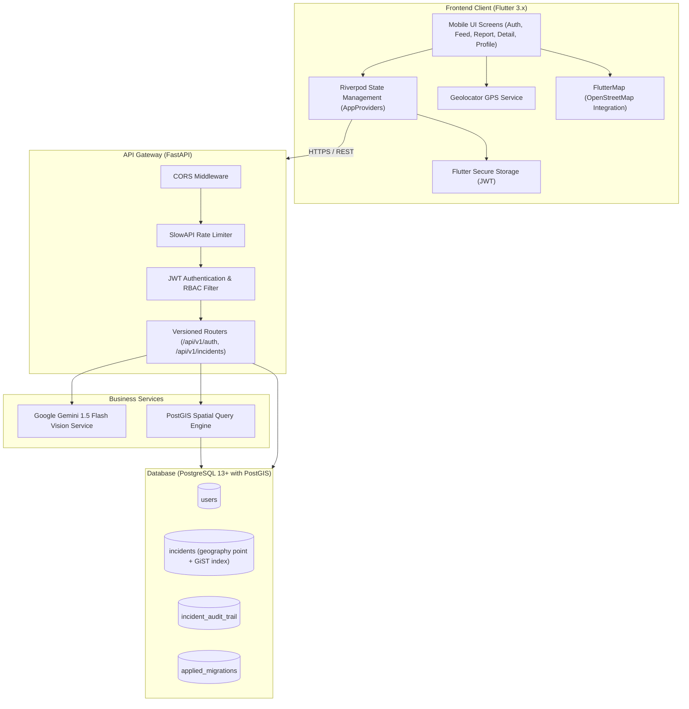
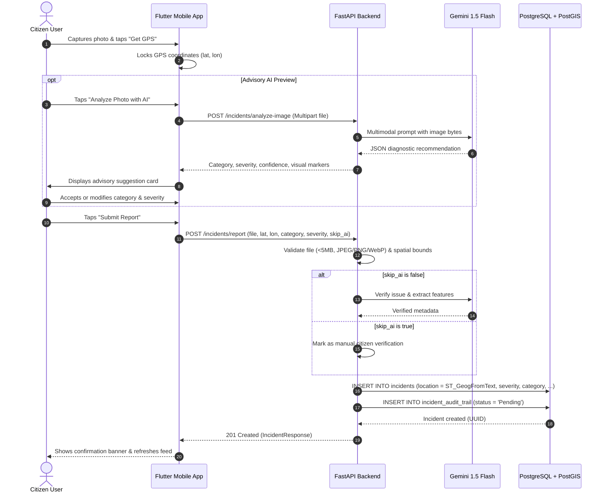
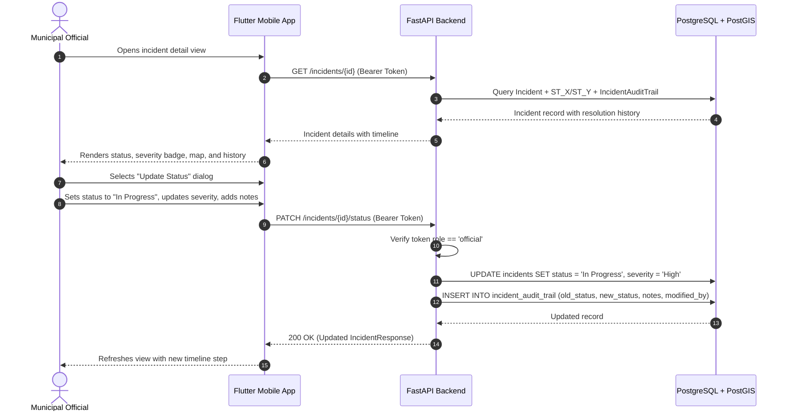

# AquaFix — System Design & Architecture Specification

---

## 1. High-Level System Architecture

AquaFix is structured around a decoupled, mobile-first client and a spatial API gateway:

---

## 2. Component Interaction & Sequence Flow

### 2.1 Incident Ingestion Flow with Advisory AI

### 2.2 Status Update & Resolution Flow

---

## 3. Technology Evaluation & Decision Log

| Component | Selected Technology | Rationale |
| :--- | :--- | :--- |
| **Backend Framework** | FastAPI (Python) | High performance via ASGI/uvicorn, built-in OpenAPI documentation, native async support, and type safety with Pydantic. |
| **Spatial Engine** | PostGIS + GeoAlchemy2 | Standard spatial database engine providing metric spherical calculations (`geography`) and GiST spatial indexing for low-latency radial queries. |
| **Mobile Client** | Flutter | Cross-platform single codebase (iOS, Android, Web, Desktop) with 60fps native rendering, material design system, and declarative Riverpod state management. |
| **AI Ingestion** | Gemini 1.5 Flash Vision | Sub-second latency for multimodal image reasoning, low token cost, and structured JSON output capabilities. |
| **Password Security** | Native `bcrypt` | Standard salted key derivation function resilient against GPU-based offline dictionary attacks. |
