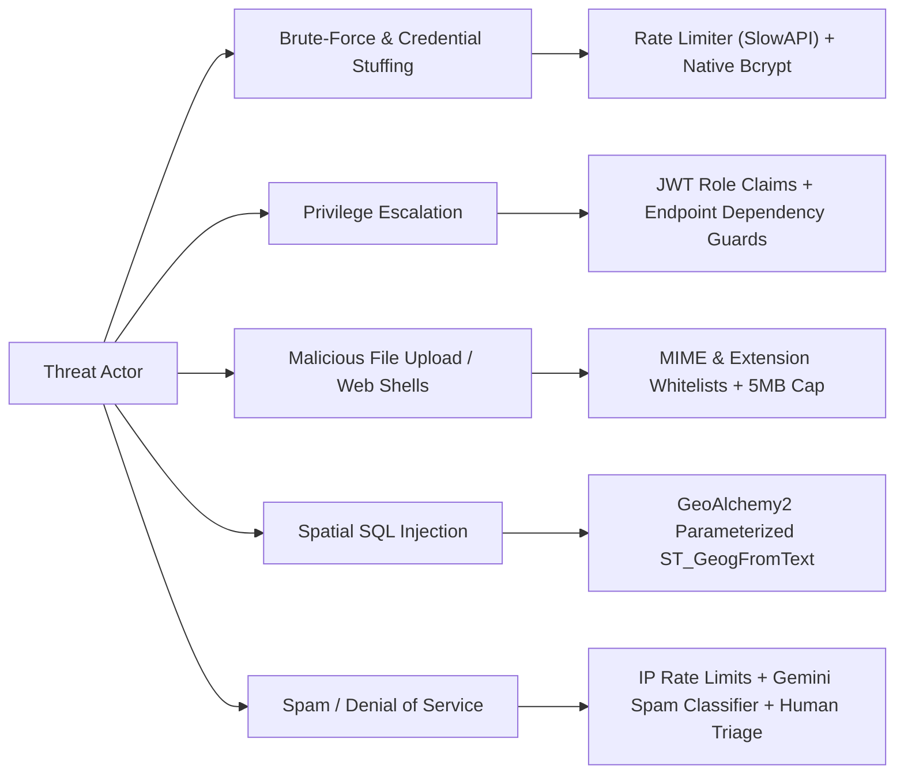

# AquaFix — Security Architecture & Threat Model

---

## 1. Threat Modeling & Mitigation Analysis

The AquaFix system threat model identifies key threat vectors and documents the controls implemented to neutralize them:

---

## 2. Role-Based Access Control (RBAC) Matrix

| Resource / Action | Unauthenticated User | Citizen Role | Official Role |
| :--- | :---: | :---: | :---: |
| **User Registration** (`POST /auth/register`) | ✅ (5/min rate limit) | ❌ | ❌ |
| **User Login** (`POST /auth/login`) | ✅ (10/min rate limit) | ❌ | ❌ |
| **View Own Profile** (`GET /auth/me`) | ❌ | ✅ | ✅ |
| **Refresh Token** (`POST /auth/refresh`) | ❌ | ✅ | ✅ |
| **AI Preview** (`POST /incidents/analyze-image`) | ✅ (15/min rate limit) | ✅ | ✅ |
| **Report Incident** (`POST /incidents/report`) | ✅ | ✅ | ✅ |
| **Browse Incident Feed** (`GET /incidents/`) | ✅ (Public transparency) | ✅ | ✅ |
| **View Incident Detail** (`GET /incidents/{id}`) | ❌ | ✅ | ✅ |
| **View Resolution History** (`GET /incidents/{id}/history`)| ❌ | ✅ | ✅ |
| **Update Incident Status** (`PATCH /incidents/{id}/status`)| ❌ | ❌ (403 Forbidden) | ✅ |
| **Delete Incident** (`DELETE /incidents/{id}`) | ❌ | ❌ (403 Forbidden) | ✅ |

---

## 3. Defense-in-Depth Implementation

### 3.1 Authentication & Session Management
- **Passwords:** Passwords hashed with native `bcrypt` using salted hashes (`$2b$12$...`). Plaintext passwords never hit the database.
- **JWT Signing:** Cryptographically signed using HMAC-SHA256 (`HS256`) with a 32+ byte secret key.
- **Token Expiry:** Tokens expire after 60 minutes (`ACCESS_TOKEN_EXPIRE_MINUTES`). Sessions can be seamlessly renewed via `POST /api/v1/auth/refresh`.

### 3.2 File Upload Defense
- **MIME Verification:** Uploads are restricted to `image/jpeg`, `image/png`, and `image/webp`.
- **Extension Whitelist:** Files must end in `.jpg`, `.jpeg`, `.png`, or `.webp`.
- **Payload Size Clamping:** Uploads over 5 MB are rejected with HTTP 413 prior to disk writes.
- **File Name Sanitization:** Uploaded files are renamed with cryptographically random UUIDs (`uuid.uuid4()`) to prevent directory traversal or file-system overwrites.

### 3.3 Rate Limiting
- Configured using SlowAPI with IP-keyed buckets:
  - User registration: 5 requests per minute per IP.
  - Login attempts: 10 requests per minute per IP.
  - AI analysis preview: 15 requests per minute per IP.
  - Exceeded limits trigger an immediate `429 Too Many Requests` response.
